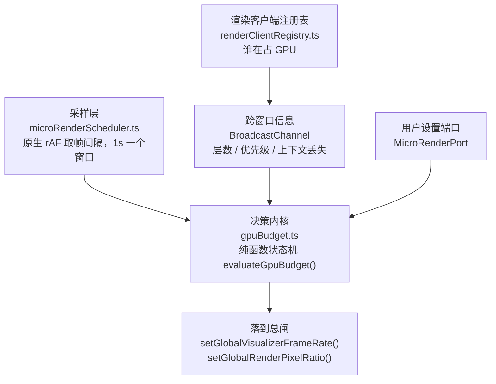
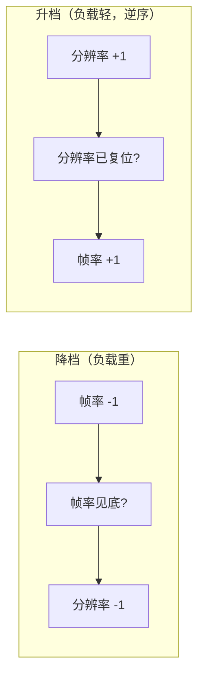
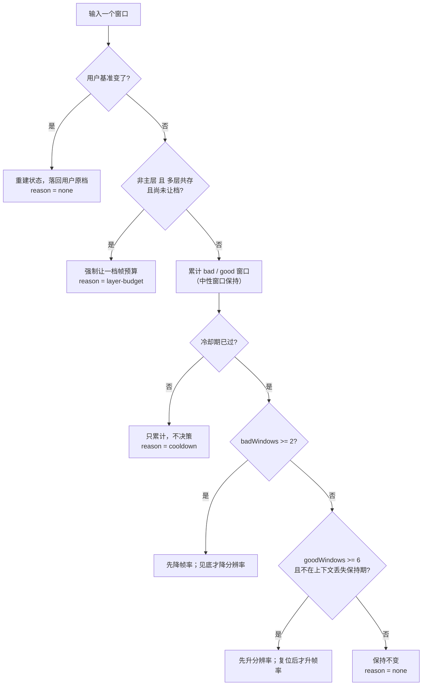

# microRender 微渲染引擎 · 算法说明

> 适用版本：Folia 整合增强版（基于 Folia-major 0.7.25）
> 本文只讲**算法**。工程接入、开关位置、设置项文案见《渲染管线GPU调度优化-20261109.md》；
> 可直接运行的零依赖内核见同包 `microRender-engine-standalone.ts`。

---

## 一、它解决什么问题

项目原本有三套互不相干的图形档位，加上一套只写报告、不驱动任何东西的帧耗时诊断：

| 原有模块 | 做什么 | 缺口 |
|---|---|---|
| `frameRateLimiter.ts` | 用户手选固定帧率上限（30/60/90/120/off） | 固定值，负载再高也不让 |
| `renderPixelRatio.ts` | 用户手选固定分辨率上限 | 固定值，不会临时降 |
| `backgroundRenderGate.ts` | 退后台一帧不画 | 只管前后台，不管轻重负载 |
| `frameTimingDiagnostics.ts` | 实测 p90 / 渲染健康度，写进开发者面板 | **默认关闭，且不驱动任何决策** |
| 28 个可视化模式 | 各自独立的渲染循环、各自一套 rAF | 多窗口同时满帧抢同一块 GPU |

microRender 补的是**「实测 → 决策 → 落到总闸」这个闭环**。它是一个**帧预算调度微内核**，
只在帧节拍层做调度，**不碰任何 shader、pass 或渲染链**，因此与 28 个可视化模式完全解耦。

三条硬约束：

1. 用户设定永远是**天花板**——只向下让预算，回升也只回到用户设的那一档。
2. 关掉开关即完整还原用户原设置——调度器不写 localStorage、不改 store。
3. 决策内核是**纯函数**（不读 window、不碰 rAF、不调全局设置），可用单测钉死。

---

## 二、四层结构



| 层 | 文件 | 职责 |
|---|---|---|
| 决策内核 | `src/utils/microRender/gpuBudget.ts` | 纯函数状态机，只回答「档位往哪边动一格」 |
| 装配 / 运行时 | `src/utils/microRender/microRenderScheduler.ts` | 采样、跨窗口协调、落闸、生命周期 |
| 客户端注册表 | `src/utils/microRender/renderClientRegistry.ts` | 带 WeakRef 的 GPU 消费者表，提供层数与优先级 |
| 开关 / 端口 | `src/stores/useMicroRenderStore.ts` + 装配层 `MicroRenderPort` | 把 store 读值与订阅以端口传入，保证 `utils` 不反向依赖 `stores` |

采样为什么自己写而不复用 `frameTimingDiagnostics`：那份是 4096 帧环形缓冲 + CPU 探针 + 长任务观察者，
设计上就该默认关闭；自动调度要默认开着，只能带一个每秒清空的小数组。两者都用**原生 rAF**
（`requestUncappedAnimationFrame`），否则会把「用户自己设的 60fps 上限」误读成掉帧。

---

## 三、档位阶梯模型

### 3.1 帧率阶梯

级数表示「相对用户基准往下让了几格」，**用户设定决定起点**，最大 3 级：

| 用户基准 | step 0 | step 1 | step 2 | step 3 |
|---|---|---|---|---|
| `off` | off | 60 | 30 | 30 |
| `120` | 120 | 90 | 60 | 30 |
| `90` | 90 | 60 | 30 | 30 |
| `60` | 60 | 30 | 30 | 30 |
| `30` | 30 | 30 | 30 | 30 |

`resolveFrameRate(user, step)` = 阶梯表查表 + `clamp(step, 0, 3)`。
阶梯到底后重复最低档，**不会无限降**；相邻两阶梯值相同时视为「降不动」，转去动分辨率。

### 3.2 分辨率阶梯

```
PIXEL_RATIO_STEPS = [2, 1.5, 1.25, 1, 0.75, 0.5]   // 降序
```

`null` 是一个特殊值，表示「跟随屏幕」，是**基准**而不是阶梯里的一档。

- 降档 `stepPixelRatioDown(current, effective)`：取阶梯里比当前生效值小的**最大**档；
  到底返回 `undefined`。
- 升档 `stepPixelRatioUp(..., user, native)`：取比当前生效值大的**最小**档；
  当 `user === null` 且已升到接近原生 dpr 时，直接撤掉上限（返回 `null`），
  不再挂一个没必要的 patch。天花板 = `user ?? native`。

### 3.3 降档 / 升档顺序（核心代价模型）



**先帧率、后分辨率**：改帧率不触发 resize 重排；改像素比会广播 resize，引发整页重排，代价明显更大。
升档严格逆序，保证「最后降的那个最先还回去」。

---

## 四、帧健康判定

### 4.1 采样

每帧记录 `delta = timestamp - lastFrameAtMs`，一个窗口 = `sampleWindowMs = 1000`。

| 规则 | 值 / 行为 |
|---|---|
| `delta > 250ms` | 判定为切后台 / 主线程长挂起，**整个窗口作废重开**（这段间隔不是渲染开销） |
| `delta <= 0` | 丢弃 |
| 一个窗口至少需要 | `MIN_SAMPLES_PER_WINDOW = 8` 帧，不足则不决策 |
| p90 | 排序后取 `sorted[floor(n * 0.9)]` |
| 显示刷新间隔 | 取 p10，夹在 `8..34ms`（约 120Hz..30Hz），再做 `0.8 * 旧值 + 0.2 * 新值` 平滑 |

p10 近似真实刷新间隔的依据：掉帧只会把间隔**拉长**，最快的一批帧仍贴着刷新率。

### 4.2 目标间隔

```
targetIntervalMs = (currentRate === 'off')
    ? displayIntervalMs
    : max(1000 / currentRate, displayIntervalMs)
```

即：用户限了帧率就按限帧后的期望间隔，没限就按屏幕刷新间隔；两者取较大者，
避免在 120Hz 屏上把 60fps 误判成掉帧。

### 4.3 好 / 坏窗口判定

```
bad  = p90 > target * 1.5  OR  slowFrameRatio > 0.25
good = NOT bad AND p90 < target * 1.1 AND slowFrameRatio < 0.08
```

`slowFrameRatio` = 窗口内 `interval > target * 1.5` 的帧占比。

**中间是「中性窗口」**：既不累加也不清零。偶发一帧抖动不该把攒了半天的证据抹掉。

---

## 五、状态机

### 5.1 状态与输入

```text
GpuBudgetState = {
  userFrameRate, userPixelRatio,     // 记录的用户基准，用来发现「用户刚改了设置」
  frameRateStep, pixelRatioStep,     // 相对基准的降级级数
  pixelRatio,                       // 当前生效的分辨率上限（null = 跟随屏幕）
  badWindows, goodWindows,          // 连续证据计数
  lastChangeAtMs, lastPixelRatioChangeAtMs
}

GpuBudgetInput = {
  p90FrameMs, slowFrameRatio, targetIntervalMs,
  userFrameRate, userPixelRatio, allowPixelRatioScaling,
  effectivePixelRatio, nativePixelRatio,
  activeLayerCount, isPrimaryLayer,
  msSinceContextLoss, nowMs
}
```

`createGpuBudgetState()` 把两个 `lastChangeAt` 初始化为「冷却期之前」，保证**装上后第一个窗口就能决策**。

### 5.2 决策流程（每个采样窗口推进一次）



任何一次**变更**都通过 `commit()`：把 `badWindows / goodWindows` 清零、更新 `lastChangeAtMs`、
输出新的 `frameRate / pixelRatio / state / reason`。

### 5.3 七种决策原因

| reason | 含义 |
|---|---|
| `none` | 本窗口无变更（含用户改档后的重建） |
| `cooldown` | 冷却期内，证据继续累计但不落闸 |
| `layer-budget` | 多层渲染共存，非主层强制让一档 |
| `degrade-frame-rate` | 坏窗口达标，降帧率 |
| `degrade-pixel-ratio` | 帧率见底，降分辨率 |
| `restore-pixel-ratio` | 好窗口达标，先还分辨率 |
| `restore-frame-rate` | 分辨率已复位，再还帧率 |

---

## 六、抑抖：滞回 + 冷却

| 参数 | 值 | 作用 |
|---|---|---|
| `badWindowsToDegrade` | 2 | 连续 2 个坏窗口才降一档 |
| `goodWindowsToRestore` | 6 | 连续 6 个好窗口才升一档（升比降谨慎 3 倍） |
| `changeCooldownMs` | 2500 | 每次变更后 2.5s 内不再变更，但**坏窗口继续累计** |
| `pixelRatioChangeCooldownMs` | 8000 | 改分辨率触发整页重排，冷却更长 |
| `contextLossHoldMs` | 8000 | 上下文丢失后 8s 内**只降不升** |
| `maxFrameIntervalMs` | 250 | 超过即判定后台挂起，窗口作废 |

设计意图：阈值边缘的一次抖动，代价可能是一次全页 resize。宁可晚 2 秒降档，也不要来回跳。

---

## 七、跨窗口 / 跨 document 协调

主窗口、壁纸叠层、桌面歌词、OBS 源是**各自独立的 HTML 入口、各自一套 rAF**，互不感知就会同时满帧。

| 机制 | 实现 |
|---|---|
| 通道 | `BroadcastChannel('folia.microRender.v1')`，消息 `hello / heartbeat / bye` |
| 心跳 | 2000ms；6000ms 未见心跳则剔除该 peer |
| 层数 | `activeLayerCount() = 1 + peers.size`（含自身） |
| 主层判定 | 按 `RENDER_PRIORITY_RANK` 比优先级：`primary(0) < overlay(1) < ambient(2) < preview(3)`，没有比我更高的就是主层 |
| 让档规则 | `minimumFrameRateStep()`：非主层且层数 > 1 → 至少 `frameRateStep = 1` |
| 升档下限 | 回升时 `nextStep >= minStep`，**不会把让出去的那一档还回来** |
| 降级 | BroadcastChannel 不可用（部分 WebView / `file://`）时自动退化为单 document 自调度，功能不缺失 |

刻意**不引入 Electron IPC**，避免桌面端与安卓端行为分叉。

`renderClientRegistry.ts` 提供同一 document 内的 GPU 消费者视图：
`primary / overlay / ambient / preview` 四级优先级，`WeakRef` 令牌让忘记注销的客户端在对象回收后自动摘除，
`usesGpu === false` 的纯 DOM 动画不计入 GPU 预算折减。

---

## 八、WebGL 上下文丢失

`webglcontextlost` 在**捕获阶段**监听（只读、不拦截）：

1. 记录 `contextLostAtMs`，`contextLossCount += 1`；
2. 立刻让出一档帧预算（若档位还能降），清零好坏窗口、刷新冷却起点；
3. 8 秒内 `contextHold = true`，状态机**只允许降、不允许升**；
4. **不调 `preventDefault()`** —— 能否恢复是各引擎 canvas 所有者的决定，越权会破坏它们自己的上下文重建流程，这里只负责把 GPU 预算降下来留出余量。

---

## 九、与用户设置、其他子系统的关系

| 关系 | 处理 |
|---|---|
| 用户改设置 | `userFrameRate / userPixelRatio` 与状态里记录的不一致 → 旧状态作废，按新基准重建并**落回用户档位** |
| 关闭开关 | `disable()` 把调度期间改过的档位**完整还给用户设置**，并拆掉所有监听、关闭通道，不留残留 |
| 退后台 / 隐藏 | `isPaused()` 暂停采样循环、清空窗口；`ignoreVisibility` 的壁纸/叠层入口跳过可见性暂停 |
| 导出补帧 | `isFrameInterpolationExportActive()` 为真时**冻结决策**——补帧花算力把帧补密，与主动丢帧省 GPU 方向相反 |
| 帧率诊断面板 | 两者共用原生 rAF，互不冲突；诊断仍默认关闭 |

---

## 十、可调参数与调优建议

全部集中在 `GPU_BUDGET_TUNING`（`gpuBudget.ts`），按真机表现收紧或放宽：

| 现象 | 建议调整 |
|---|---|
| 高负载下降档太慢、仍卡顿 | 调小 `badWindowsToDegrade`（2 → 1）或 `slowP90Factor`（1.5 → 1.3） |
| 边缘负载来回跳档 | 调大 `goodWindowsToRestore`、`changeCooldownMs` |
| 分辨率变化引起肉眼可见的重排 | 调大 `pixelRatioChangeCooldownMs`，或直接关 `allowPixelRatioScaling` |
| 高刷屏误判掉帧 | 检查 p10 的 `8..34ms` 夹取范围是否覆盖该设备刷新率 |
| GPU 驱动恢复后立刻又升档 | 调大 `contextLossHoldMs` |

---

## 十一、独立内核与自检

交付包里的 `microRender-engine-standalone.ts` 是决策内核的**零依赖抽取版**：
内联了项目 `src/types.ts` 里的两个类型，不含任何 DOM / rAF / 项目内部 import，可直接嵌入任何渲染引擎。

```bash
node --experimental-strip-types microRender-engine-standalone.ts   # Node 22+
```

内置 5 条自检（`runSelfTest()`，实跑全过）：

| # | 用例 | 期望 |
|---|---|---|
| 1 | 单个坏窗口 | 不降档（滞回生效） |
| 2 | 连续两个坏窗口 | 60 → 30，降一档 |
| 3 | 用户设 30 且连续 8 个好窗口 | `frameRateStep` 仍为 0，不升破天花板 |
| 4 | 非主层 + 2 层共存 | 120 → 90，强制让一档 |
| 5 | 用户中途把 60 改成 90 | 状态重建，落回 90 且 `frameRateStep = 0` |

---

## 十二、文件清单

| 文件 | 作用 |
|---|---|
| `src/utils/microRender/gpuBudget.ts` | 决策内核（纯函数） |
| `src/utils/microRender/microRenderScheduler.ts` | 采样 / 协调 / 落闸运行时 |
| `src/utils/microRender/renderClientRegistry.ts` | GPU 消费者注册表 |
| `src/utils/microRender/index.ts` | 导出 |
| `src/stores/useMicroRenderStore.ts` | 开关状态与端口 |
| `microRender-engine-standalone.ts` | 零依赖独立内核（交付包内） |
| 本文 | 算法说明 |

> 说明：**色散玻璃导航条（liquidGlass）与 microRender 是正交的两件事**——
> 前者是叠加的视觉效果，后者是渲染调度微内核，二者互不影响。
